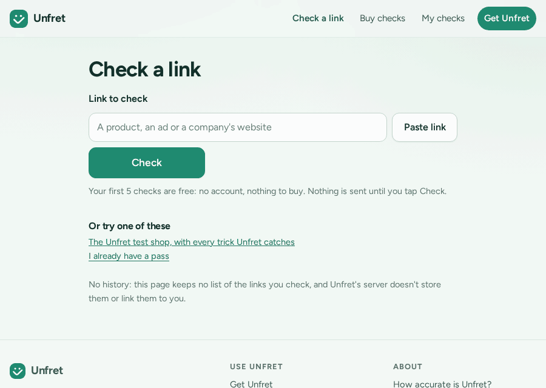

# Unfret browser extension



Risk signals for the product page you're looking at: Temu-grade listings on Amazon dressed up with thousands of
five-star reviews, dropship stores, fake countdowns, pre-ticked add-ons and fees that only appear at checkout.
Unfret reports evidence and a plain-words verdict; it never calls a shop a scam.

Chrome (Manifest V3) and Firefox, from one source. Vanilla TypeScript, no UI framework, no remote code, no
third-party requests: the extension talks to the Unfret API and nothing else.

**Install:** from the [Chrome Web Store](https://chromewebstore.google.com/detail/unfret/giiengbpechhnphignbicmlcbklmcpjo)
(Chrome, Brave, Edge and other Chromium browsers); Firefox is being submitted to addons.mozilla.org
([store/AMO.md](store/AMO.md)) and Edge to Microsoft Edge Add-ons ([store/EDGE.md](store/EDGE.md)). All are built
byte for byte from this repository. The older self-hosted install is
described in [INSTALL.md](INSTALL.md), but no longer offered.

- Website: [unfret.net](https://unfret.net) · [check a link](https://unfret.net/check) ·
  [developers and AI agents](https://unfret.net/developers)
- The service behind it (API, website, scoring):
  [git.kroshtan.com/kroshtan/unfret_backend](https://git.kroshtan.com/kroshtan/unfret_backend) ·
  [GitHub mirror](https://github.com/kroshtan/unfret_backend)
- Android app: [git.kroshtan.com/kroshtan/unfret_android](https://git.kroshtan.com/kroshtan/unfret_android) ·
  [GitHub mirror](https://github.com/kroshtan/unfret_android)
- This extension: [git.kroshtan.com/kroshtan/unfret_extension](https://git.kroshtan.com/kroshtan/unfret_extension) ·
  [GitHub mirror](https://github.com/kroshtan/unfret_extension)

## How accurate it is

The extension reads the page; the verdict comes from the Unfret service. On Unfret's labelled corpus of **1,582
product pages** (scam shops, junk and dropshipping, and legitimate shops), replayed through the analysis with the open
baseline model, the score has a **ROC AUC of 0.897**:

| Verdict          | Pages | Scam or junk among them |
| ---------------- | ----- | ----------------------- |
| Serious concerns | 282   | 95%                     |
| Think twice      | 423   | 82%                     |
| Worth a look     | 404   | 46%                     |
| Looks fine       | 464   | 7%                      |

Think twice or Serious concerns catches 74% of the scam and junk pages, with 12% of legitimate pages getting one
(false alarms). The corpus includes the pages the model was trained on, so expect somewhat lower numbers on new pages;
details in the [backend's README](https://git.kroshtan.com/kroshtan/unfret_backend#how-accurate-it-is).

**The model.** The scoring model in the backend repository is an open baseline, and a self-hosted Unfret uses it.
The service at unfret.net runs privately retrained versions of it. The labelled corpus and the duplicate-product image
dataset are private.

## Run it against your own server

Start the backend on your machine ([its README](https://git.kroshtan.com/kroshtan/unfret_backend#run-your-own):
Docker Compose, an LLM API key, two secrets), build the extension (`make install build-dev`), load `dist/chrome` or
`dist/firefox` unpacked (see [Development](#development)) and set the API base in the extension's settings to
`http://localhost:8080`. The settings accept only `localhost` and `127.0.0.1`; for a server elsewhere, change the API
origin in `scripts/manifest.mjs` and build your own copy.

## How it works

```
toolbar click ─► popup ─► background ─► inject extract.js into the tab ─► PageFacts + cleaned text
                                   ├─► GET /v1/analyze/challenge ─► proof of work (deep check only)
                                   └─► POST /v1/analyze/stream (no Authorization) ─► live steps ─► the result
```

- **Free for shoppers, with no account.** There is no pass, no sign-in and no wallet: the extension sends nothing that
  names you with a check, and keeps no account. Versions before 0.14.0 kept a pass or a wallet sign-in; it is deleted
  on update (and whenever the popup or settings open), never sent again.
- **Nothing runs until you click "Check this page" or "Quick check (free)".** "Check this page" is a free deep check:
  the background gets a challenge (`GET /v1/analyze/challenge`), solves its proof of work (a few seconds of SHA-256 in
  the service worker, never in the popup; `src/shared/pow.ts`, the same puzzle as the website's) and sends the check
  with it. The quick check under it reads only the page, by Unfret's rules. When free deep checks are paused (the
  monthly spend ceiling: the challenge, `/v1/pricing` or `FREE_CHECKS_PAUSED` says so), nothing is solved, the popup
  says free checks run on donations, with a "Support Unfret" link to `/donate`, and the main button is the quick
  check; a deep check that can't be offered right now (503) becomes a quick check too, saying why. The extension
  has no standing access to any website: it reads a page only through `activeTab`, which the browser grants for that
  one tab when you click the toolbar button. On supported marketplace product pages (Amazon, all countries; bol.com)
  the toolbar icon gets a small amber marker; in Chromium the browser sets it itself from the page address
  (`declarativeContent`), without the extension seeing the page.
- **Unfret's own site isn't checked**, nor browser and store pages, except the **test shop** (`/test-shop` on the
  API base: a made-up store with every trick Unfret catches, for demos and trying the extension out).
- **Extraction happens in the browser.** `src/extract/` is a TypeScript port of the backend's PageFacts
  extractors (`facts/*.py`). It also adds what only the rendered page shows: text hidden by stylesheet CSS,
  the current state of checkboxes, and countdowns read twice a few seconds apart.
- **Only facts and cleaned product text are sent**, never the raw page: account menus, greetings, forms and inputs,
  checkout, billing and delivery areas are stripped from a copy of the page first. Addresses are kept only where the
  business publishes its own (a contact, legal or imprint section, the footer, Organization or address structured
  data); an address anywhere else could be yours and is stripped. The same rules decide which phone numbers, e-mail
  addresses and addresses go into the facts (`src/extract/business.ts`, a port of the backend's `facts/business.py`).
  On classifieds platforms (Marktplaats, 2dehands, Vinted, Craigslist, Facebook Marketplace) the seller's name is
  never read, and only product IDs and payment methods are read as business facts there (also on eBay).
- **The app traces in the markup travel as names, not HTML.** A shop's apps show in its markup rather than its text (a
  review importer's widget class, a dropshipping app's data attribute, a product photo on the supplier's CDN), which
  the backend's source checks read from raw HTML. The facts carry them as `markup_names` (class names, ids and
  data-attribute names, never their values) and `external_refs` (the other sites the page refers to: a link's host
  and path, anything else's host, never a query), outside the private areas above (`src/extract/markup.ts`, a port of
  the backend's `facts/markup.py`). So a quick check of the test shop gives the same verdict from the extension as
  from the link checker. Still only on a fetched page: what only inline scripts or attribute values name.
- **Addresses without secrets.** Every Unfret page the extension opens and every link it shows goes through
  `withoutSecrets` (`shared/urls.ts`): query parameters and fragments that look like a secret are dropped. The address of a page you check goes through `checkedUrl`: no
  fragment, user name or password, and no tracking or referral parameters, sessions, tokens or e-mail addresses (the
  backend's list, kept equal by `make parity`); what picks the product or its variant stays.
- **"Share this result"** asks the API for a preview of the public page (`POST /v1/shares/preview`), and only on
  "Share" makes it (`POST /v1/shares`), both without Authorization, so the page names no one. The link and its
  delete code stay with the tab's result in session memory.
- **English only.** The extension's own text is English; the verdict's wording is the server's, shown as it comes.

The API contract is in the backend repository (`docs/api-contract-v1.md`, "Free checks for shoppers").

## Layout

```
src/
  background/   service worker / event page: icon hint, badge, analysis runner (with the proof of work)
  content/      extract-entry.ts (injected on demand, into the tab you clicked on only)
  extract/      PageFacts extraction: parse, dom, generic, business, p2p, amazon, bolcom, walmart (ports); live, clean (browser-only)
  api/          API client and SSE parser
  popup/        popup UI
  options/      options page (API base URL)
  shared/       facts types + JSON schema, settings, sites, messages, pow (the proof of work); ui.css (the website's look) and fonts/
                (Figtree, bundled: no remote fonts)
scripts/        build (esbuild, per-browser manifests, zips), icons, gen_parity.py
test/           unit, parity (jsdom vs the Python extractors), mock API; smoke/ (headless Chromium)
```

## Permissions

| Permission                                          | Why                                                                     |
| --------------------------------------------------- | ----------------------------------------------------------------------- |
| `activeTab`                                         | Read the page you clicked on (any shop, marketplaces too), only then    |
| `scripting`                                         | Inject the extractor into that tab                                      |
| `storage`                                           | Your consent and settings; nothing else                                 |
| `declarativeContent` (Chromium)                     | The browser marks the icon on marketplace product pages; no page access |
| optional `http://localhost/*`, `http://127.0.0.1/*` | Only if you point the extension at a local dev server                   |

## Development

```bash
make install          # npm ci
make test             # unit + parity tests
make lint typecheck
make build-dev        # dist/chrome, dist/firefox (unminified, source maps)
make smoke            # build + headless Chromium run (first: npx playwright install chromium)
make parity           # regenerate expectations from the backend's Python extractors (BACKEND=../unfret_backend)
```

Load unpacked:

- **Chrome**: `chrome://extensions` → Developer mode → Load unpacked → `dist/chrome`.
- **Firefox**: `about:debugging#/runtime/this-firefox` → Load Temporary Add-on → `dist/firefox/manifest.json`.
  Firefox has no `declarativeContent`, so it shows no marketplace marker; analysis works the same.

To use a local backend, set the API base in the extension's settings to e.g. `http://localhost:8080` (the browser
asks for access to that address; see [Run it against your own server](#run-it-against-your-own-server)).

`make build` writes four builds: `dist/chrome` (the store variant, zipped as `dist/unfret-chrome-<version>.zip`),
`dist/chrome-selfhosted` (with the update URL and public key, signed into a CRX by `make release`), `dist/chrome-dev`
and `dist/firefox` (built, not published).

`dist/chrome-dev` is **Unfret Dev**: a separate extension (ID `phokojgbhkfcejnnocokabdjoljdfgpl`, grey icon with a
DEV label) that talks only to the dev deployment (dev.unfret.net, devnet) and updates from there. Install it
next to Unfret to test; the production extension never talks to dev. The version comes from `package.json`. `make release` produces the signed
self-hosted release in `dist/release/` (see [INSTALL.md](INSTALL.md#for-maintainers-making-a-release)).

### Pull requests and CI

CI (`.forgejo/workflows/ci.yaml`) checks a pull request once it is ready to merge, not every push while it's being
worked on:

- **Open it as a draft:** start the title with `WIP:` (for example `WIP: Shorter result card`). Forgejo shows it as
  a work in progress and CI skips it, however often you push.
- **Ready to merge? Take `WIP:` off the title.** That starts CI on the newest commit. Merge when it's green.
- A push to a ready pull request runs CI again and cancels the run still going for the commit before. Editing its
  description or title doesn't check it again: that run reports the result the commit already has (to retry a
  failure that wasn't the code's, re-run its run under Actions).
- Back to work on it: put `WIP:` back in front.

On `main`, runs queue one behind the other and are never cancelled, so an Unfret Dev publish is never cut off or
dropped. A run whose commit is no longer `main`'s newest when it starts checks nothing and doesn't publish: the
newest commit's run checks and publishes it.

## Releases (CI/CD)

- **Merge to `main` ⇒ Unfret Dev.** CI (`.forgejo/workflows/ci.yaml`, job `publish-dev`) builds Unfret Dev as
  `<version>.<run number>`, signs it and opens a self-merging pull request on the backend, whose pipeline deploys it to
  dev.unfret.net.
- **Production ⇒ by hand only.** Actions → "Release to the extension stores" (`release-store.yaml`, manual) builds and
  checks the store packages (Chrome, Firefox and the source zip addons.mozilla.org asks for), attaches them to the
  release `v<version>` and submits them (`scripts/store-publish.mjs`): the Chrome zip to the Chrome Web Store for
  review (API v2, OAuth refresh token or a service account), the Firefox zip with its source as a new listed version on addons.mozilla.org
  (API v5), and the Chrome zip to Microsoft Edge Add-ons for certification (API v1.1, API key). Inputs pick the
  stores (all, chrome, firefox, edge, none) and a dry run (the default) that only shows the requests. A store
  without its secrets is skipped, and the step passes (CI checks this on every pull request). See
  [store/SUBMIT.md](store/SUBMIT.md), [store/AMO.md](store/AMO.md) and [store/EDGE.md](store/EDGE.md).
- **Backend first.** `minBackendVersion` in `package.json` is the oldest backend release that accepts this
  extension's page data (newer extensions send fields and platform values older backends refuse with 422). The store
  workflow refuses to submit while https://unfret.net/v1/health reports an older `version`. Raise it whenever the
  extension starts sending something only a newer backend knows.

## Parity with the backend

The same HTML must give the same PageFacts in the browser as on the server, or the scorer sees different
features than it was trained on. `test/parity.test.ts` runs the TypeScript extractors over `test/fixtures/*.html`
and compares them field by field with the Python extractors' output (`*.expected.json`), and validates against the
backend's PageFacts JSON schema. When the backend's extractors change, run `make parity` and port the change.
`make parity` also writes `test/fixtures/url-params.expected.json`, the query parameters the backend drops from a page
address, which `test/urls.test.ts` compares with the extension's `checkedUrl` lists.

The live-only additions (stylesheet-hidden text, live checkbox state, observed countdowns) deliberately go beyond
the server's view; they are conservative so as not to skew the scorer, and the scorer should eventually be
retrained on extension-sourced facts.

## License

MIT. The Figtree typeface in `src/shared/fonts/` is under the SIL Open Font License 1.1
([OFL-Figtree.txt](src/shared/fonts/OFL-Figtree.txt)). See [PRIVACY.md](PRIVACY.md) for what is sent and stored.
